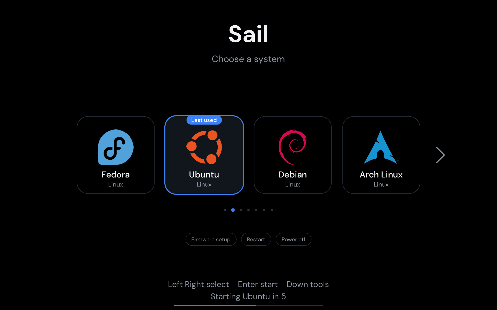

# Sail

A graphical UEFI boot menu with big tiles, written in Rust. It finds the systems installed on your machine, shows each as a tile with its logo, and starts the one you pick. It works with Secure Boot on.



*A QEMU run with stand-in entries; Ubuntu was the last system started.*

> **Experimental.** Sail is a boot loader, and a mistake can leave a machine that will not boot. It has been tested on one machine only (a Lenovo ThinkStation P620 with Fedora and Windows 11, Secure Boot on). Keep a recovery USB and do not try it on a machine you cannot repair.

## Features

- Finds Fedora, Windows, Ubuntu, Debian, Arch Linux, openSUSE and Linux Mint on any disk, plus any other disk that has `\EFI\BOOT\BOOTX64.EFI`.
- Four tiles in view, scrolling for more. Keys: Left and Right, number keys, Enter.
- Remembers the last system you started: it gets a "Last used" pill and the countdown starts on it.
- A row of tools under the tiles (press Down): Firmware setup, Restart and Power off.
- Countdown of 8 seconds on the first tile; any key stops it.
- Starts a system by chainloading its own EFI file. It never edits or replaces another boot loader.
- Draws at up to 1920x1200, even on a 4K screen, to stay fast.
- Works with Secure Boot through shim and a key you enroll yourself (MOK).

**Not included:** reading GRUB menus, kernel options, or managing boot entries. Linux systems start through their own shim and GRUB. x86_64 UEFI only.

## Build

```bash
rustup target add x86_64-unknown-uefi
cargo build --release
```

The result is `target/x86_64-unknown-uefi/release/sail.efi`.

## Install

Try Sail with a one-time boot first, and keep your usual entry first in the boot order. Use your own disk and partition numbers (`lsblk`, `efibootmgr -v`); `/dev/nvme0n1` and `1` below are examples.

### Secure Boot off

```bash
sudo mkdir -p /boot/efi/EFI/sail
sudo cp sail.efi /boot/efi/EFI/sail/sailx64.efi
sudo efibootmgr --create --disk /dev/nvme0n1 --part 1 --label Sail --loader '\EFI\sail\sailx64.efi'
sudo efibootmgr --bootnext <number of the new entry>
```

Then reboot.

### Secure Boot on

The firmware does not trust Sail's signature, but shim can trust a key you enroll.

1. **Sign Sail** with your own key. Sail already contains the `.sbat` section that shim needs.
   ```bash
   openssl req -new -x509 -newkey rsa:2048 -sha256 -days 3650 -nodes -subj "/CN=Sail/" -keyout sail.key -out sail.crt
   sbsign --key sail.key --cert sail.crt --output grubx64.efi sail.efi
   ```
2. **Enroll the key.** Pick a one-time password, reboot, and on the blue screen choose Enroll MOK, Continue, Yes, then type the password.
   ```bash
   openssl x509 -in sail.crt -outform DER -out sail.der
   sudo mokutil --import sail.der
   ```
3. **Copy the files.** Shim starts the file named `grubx64.efi` in its own folder. These paths are Fedora's; change them for your distribution.
   ```bash
   sudo mkdir -p /boot/efi/EFI/sail
   sudo cp /boot/efi/EFI/fedora/shimx64.efi /boot/efi/EFI/fedora/mmx64.efi /boot/efi/EFI/sail/
   sudo cp grubx64.efi /boot/efi/EFI/sail/
   ```
4. **Add the entry** and boot it once.
   ```bash
   sudo efibootmgr --create --disk /dev/nvme0n1 --part 1 --label "Sail (Secure Boot)" --loader '\EFI\sail\shimx64.efi'
   sudo efibootmgr --bootnext <number of the new entry>
   ```

Keep `sail.key` private and out of git: whoever has it can sign code that your machine will trust.

### Make it the default

When the one-time boot works, move the Sail entry first: `sudo efibootmgr -o <Sail number>,<the others>`. Re-read `efibootmgr` before you do, because entry numbers can change.

## Recovery and removal

- If Sail fails, open the firmware boot menu (often F12) and start another entry directly. Your other systems are untouched.
- To remove Sail, delete its entry with `sudo efibootmgr -B -b <number>` and delete the `EFI/sail` folder on the EFI partition.

## Project layout

| Path | What |
|---|---|
| `src/main.rs` | the whole boot menu |
| `assets/` | DM Sans font and logo masks (see `NOTICE.md`) |
| `docs/` | preview image |

## License

MIT for Sail's code (see `LICENSE`). The font and logos have their own terms in `NOTICE.md`. The distribution logos are trademarks of their owners, and Sail is not affiliated with them.
